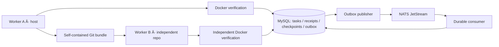
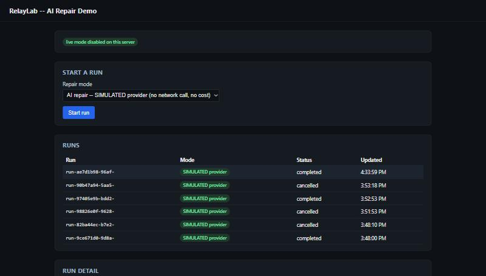
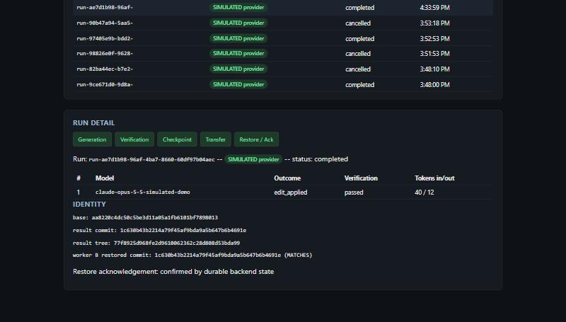

<p align="center"></p>

<p align="center">
  <a href="https://github.com/ns-0437/relaylab/actions/workflows/ci.yml"></a>
  
  
  
</p>

<p align="center"><strong>A coding worker can die. Its verified progress should not disappear.</strong></p>
<p align="center"><a href="#try-the-handoff">Run the demo</a> · <a href="docs/ARCHITECTURE.md">Architecture</a> · <a href="docs/EXECUTION.md">Execution</a> · <a href="docs/KUBERNETES.md">Kubernetes</a> · <a href="docs/VALIDATION.md">Evidence</a></p>

RelayLab explores the infrastructure underneath a dependable coding agent: who owns a task, which command already committed, which Git state was verified, and how another worker can resume it without trusting stale authority.

The demo repairs a small repository, verifies the candidate in a constrained Docker container, records a durable checkpoint, and transfers ownership to a second worker. That worker restores a self-contained Git bundle into an independent repository, verifies it again, and acknowledges the handoff.

**The repair is deterministic.** There is no live LLM, hosted service, or polished agent UI yet. The difficult part explored here is recovery correctness.

## What makes this interesting

| Failure | Mechanism | Where to inspect it |
| --- | --- | --- |
| A stale worker writes after handoff | Ownership epochs and database-time lease checks | [Task store](src/db/task-store.ts) |
| A successful command response is lost | Authorized receipt replay and payload fingerprints | [Retry tests](tests/integration/retry-authorization.test.ts) |
| A broker redelivers after a crash | Transactional outbox, durable deduplication, sequence-gap handling | [Consumer](src/messaging/consumer.ts) |
| A worker dies after producing Git state | Checkpoint identity and reconciliation of committed work | [Crash scenarios](tests/integration/git-worker-crash.ts) |
| An artifact is wrong or incomplete | Bundle digest/size checks and independent restore verification | [Handoff](src/worker/handoff.ts) |
| Verification hangs or changes its input | Runtime/output limits, cleanup, final input-integrity check | [Docker adapter](src/worker/docker-verify.ts) |
| A local service pod is replaced | Persistent state, dependency-aware readiness, explicit exclusivity | [Kubernetes runbook](docs/KUBERNETES.md) |

## How the pieces fit



**In local Kubernetes:** publisher, consumer, MySQL, NATS. **On the host:** Git workers, bundles, and Docker verification. Kubernetes does not schedule verification Jobs in this version.

## Try the handoff

Install **Node 24**, **Git**, and **Docker with Linux containers**. Run commands from the repository root. The Compose configuration uses local development credentials and localhost ports.

```bash
git clone https://github.com/ns-0437/relaylab.git
cd relaylab
npm ci
npm run typecheck
npm run build
npm run test:unit

docker compose -f infra/compose.yaml up -d --wait mysql nats
npm run migrate
npm run docker:build-verify-image
npm run demo:handoff
```

The demo should report matching source/restored Git identities, distinct verification executions, and one logical restoration acknowledgement. These are acceptance conditions, not fabricated sample output.

For setup details, Windows notes, configuration, and troubleshooting, see [Quickstart](docs/QUICKSTART.md). For the local cluster, follow [Kubernetes](docs/KUBERNETES.md).

## AI repair mode

An explicit second repair mode alongside the scripted one above: the worker asks Claude (via the official `@anthropic-ai/sdk`) to generate the fix for the same fixture's known bug, instead of applying a hardcoded substitution. The generated edit still goes through every existing guarantee -- the same worktree/identity checks, the same path-allowlisted commit, the same real Docker verification, the same durable checkpoint. It never checkpoints on a failed verification.

Setup:

```bash
export ANTHROPIC_API_KEY=sk-ant-...        # read from the environment only; never hardcoded
export RELAYLAB_AI_MODEL=claude-opus-5-5   # required explicitly for a live call (or RELAYLAB_AI_ALLOW_DEFAULT_MODEL=1)
npm run demo:ai-repair -- --live           # the explicit opt-in a real, PAID API call requires
```

Without `--live` (or `RELAYLAB_AI_REPAIR_LIVE=1`), the demo makes no network call and prints what it would do -- this is also the default for `npm test`, which never spends tokens.

Execution boundaries: at most 2 end-to-end attempts (generate -> commit -> real Docker verify), bounded by an overall deadline (`DEFAULT_OVERALL_DEADLINE_MS`, 100s) comfortably inside the project's existing 120s task-claim lease, which is explicitly renewed before each attempt -- if ownership is lost mid-run (another owner takes over, or the epoch moves), the run stops immediately via TaskStore's own fencing, never checkpointing. Each provider call disables the SDK's own retries (`maxRetries: 0`, so the 2-attempt bound also bounds real HTTP calls) and is bounded on output tokens (`RELAYLAB_AI_MAX_OUTPUT_TOKENS`, default 2048, ceiling 8192) and timeout (`RELAYLAB_AI_TIMEOUT_MS`, default 60000ms, ceiling 180000ms). The model can only produce a structured JSON edit for the one allowlisted file (`src/add.js`) -- there is no tool-use surface, so it cannot choose a shell command or any other path; tests, verification scripts, configuration, and symlinked repair targets are always rejected, and identical (no-op) output is its own explicit outcome, never an empty commit. A restart that finds an already-committed-but-unverified or interrupted-but-validated prior attempt resumes it directly rather than regenerating; any OTHER unexpected workspace modification is refused, never discarded. Checkpoints from this mode feed the SAME handoff/artifact/restore-acknowledgement path the deterministic mode uses, unmodified. This does not claim exactly-once provider execution or a guaranteed billing cap -- see `tests/unit/ai-repair.test.ts`, `tests/unit/anthropic-client.test.ts` (a real SDK client against a local fake transport, proving the retry/timeout behavior above), and `tests/integration/git-worker-ai.test.ts` (including the full AI-edit-to-handoff-acknowledgement scenario) for what is actually tested, all with clearly labeled SIMULATED provider responses.

Inspecting evidence: each attempt's model, outcome, and token usage are printed by the demo and returned from `runAiRepairTask` -- never the prompt or raw response text. A successful run's checkpoint is queryable the same way the deterministic path's is (`task_checkpoints` / `command_receipts`, keyed by `checkpointCommandId(taskId)`).

## Demo UI

A small local HTTP API (`src/api/`, plain `node:http`, no web framework) plus a TypeScript + React UI (`ui/`, bundled locally with esbuild -- no CDN, no runtime network dependency to load React), so the pipeline above is clickable rather than CLI-only. This is a **local, single-process, one-run-at-a-time demo** -- never a distributed job queue -- and it makes **no real API calls unless you explicitly enable live mode**.

```bash
docker compose -f infra/compose.yaml up -d --wait mysql nats
npm run docker:build-verify-image   # once, if not already built
npm run migrate                     # applies 0013_demo_runs.sql / 0014_demo_api_lock.sql among others
npm run demo:ui                     # builds the UI (ui/dist/), then starts the API + serves it
```




Open **http://127.0.0.1:4555** (binds to loopback only by default; override with `RELAYLAB_API_HOST`/`RELAYLAB_API_PORT`). Pick a mode, click **Start run**, and watch the stage timeline (Generation -> Verification -> Checkpoint -> Transfer -> Restore/Ack) advance via completion-based polling (the next `GET /api/runs` request is scheduled only once the current one resolves, every ~2s -- never overlapping requests) -- every stage shown is read from the `demo_runs` table (a durable row, not a local timer), including the actual model used, token usage, commit/tree identifiers, and a "MATCHES" check between worker A's result and worker B's independently restored/re-verified result. A terminal run's later stages are shown as explicitly "skipped", never "pending" (which would wrongly imply they still might happen).

**Modes:**
- **AI repair -- SIMULATED provider** (default): no network call, no cost, real Git/Docker/MySQL/handoff throughout.
- **Deterministic scripted repair**: no AI at all, same pipeline.
- **AI repair -- LIVE provider**: disabled unless the server is started with `RELAYLAB_LIVE_MODE=1` AND `ANTHROPIC_API_KEY`/`ANTHROPIC_AUTH_TOKEN` AND `RELAYLAB_AI_MODEL` are all set, AND the UI's confirmation checkbox ("I understand this will make a real Anthropic API call and incur real charges") is checked for that specific request. A failed live call is reported as a failure -- it is never silently replaced with simulated output.

**API:** `POST /api/runs {mode, confirmPaidCall?}`, `GET /api/runs`, `GET /api/runs/:id`, `POST /api/runs/:id/cancel`. Both mutating endpoints apply the SAME validation: a body, if sent, must be `Content-Type: application/json`; a browser `Origin` header that isn't this server's own loopback origin is rejected (403); only the fixed mode allowlist is ever accepted -- never a repository path, shell command, or provider URL. A second `POST /api/runs` while one is active returns 409. A failed durable-lifecycle write is reported as a sanitized `storage_error` (never an arbitrary error message) and does NOT leave the demo permanently stuck -- a subsequent start still succeeds. Credentials are never included in any response.

**Singleton lock + restart behavior:** a second server instance against the SAME database refuses to start at all (reusing the project's existing `publisher_leader` epoch-lock mechanism under its own `lock_name`, "demo-api") -- it can never reconcile or otherwise touch runs a genuinely running first instance owns. On startup (once the lock is held), the server reconciles `demo_runs`: any row left in an in-flight status by a prior process is marked `interrupted` -- there is no way for this single-process model to resume an in-flight JS execution across a restart, and a dead process is never displayed as still running. Shutdown (`Ctrl+C`, SIGINT/SIGTERM) immediately blocks admission and requests cancellation. It waits up to `RELAYLAB_SHUTDOWN_TIMEOUT_MS` (default 15000) and explicitly reports a timeout if cleanup is incomplete.

**Tests:** API admission, cancellation, singleton ownership, lifecycle failure handling, and simulated-provider Git/Docker handoff have focused automated tests. See [release validation](docs/RELEASE-2026-10-17.md) for exact results and scope. Browser screenshots document manual interaction; they are not automated browser acceptance.

**Current limitations:**
- No authentication -- loopback-only binding, origin checking, and the singleton lock are the only access/contention controls; do not expose this port beyond localhost.
- Single active run, single process, no persistence of the AbortController across a restart -- by design, stated as the local execution model this is, not a limitation to be read as a bug.
- Deterministic and restore cancellation use a slow test-only fixture so the container-running barrier can be exercised; the production fixture remains unchanged.
- The browser-driven workflow in this repository was run manually via the built-in browser tool during development, with real evidence captured (screenshots, accessibility-tree reads); it is not yet wired into `npm test` as an automated headless browser suite.
- Graceful shutdown's own SIGINT/SIGTERM wiring was exercised via the test suite's own `shutdown()` calls (which exercise the same code path: stop server, cancel+await active run, release lock, close pool) but not via an actual OS signal on this Windows development host, where forcefully stopping a process bypasses Node's signal handlers entirely.

## Break it deliberately

```bash
# Requires real MySQL, NATS, and the verification image above.
# Uses a disposable test database; run suites sequentially.
npm run test:integration
npm run test:git-worker-crash
npm run test:handoff-crash
```

The harness pauses real child processes at named failure points and terminates them. Recovery assertions inspect durable rows, Git identities, and container state. They do not infer correctness from a clean process exit.

| Validation layer | Infrastructure | Scope |
| --- | --- | --- |
| Build, typecheck, unit tests | Node 24 | Fast checks; automated in CI |
| Integration tests | MySQL, NATS, Docker | Transaction, messaging, Git, and execution behavior |
| Crash scenarios | Real child processes + local dependencies | Recovery across controlled termination points |
| Kubernetes demos | kind, kubectl, local images | Deployment and recovery of coordination services |

[Validation notes](docs/VALIDATION.md) separate fresh publication checks from historical development results. A green CI badge does **not** mean every infrastructure scenario ran in GitHub Actions.

## Stack, with a purpose

| Technology | Responsibility |
| --- | --- |
| TypeScript + Node 24 | Strictly typed services, workers, and process harnesses |
| Effect | Typed task-store service and error boundaries |
| MySQL | Ownership, receipts, checkpoints, outbox, deduplication |
| NATS JetStream | Durable at-least-once event transport |
| Git | Commit/tree identity and portable checkpoint bundles |
| Docker | Bounded local verification execution |
| OpenTelemetry | Traces and context propagation |
| Prometheus + Grafana | Durable-state metrics, alerts, dashboards |
| Kubernetes + kind | Local coordination-service deployment |

Dependency versions are recorded in [package-lock.json](package-lock.json). Vitess compatibility, Electron, Rust, and live model integration are not claimed.

For a guided code review, follow the [reviewer’s tour](docs/DEMO.md).

## Design decisions worth reading

- [Ownership fencing](docs/decisions/0001-ownership-fencing.md): an owner name is not enough.
- [Receipt authorization](docs/decisions/0004-receipt-authorization.md): replay is different from a new write.
- [Explicit-path commits](docs/decisions/0010-explicit-path-commits.md): unrelated workspace changes must not enter a checkpoint.
- [Handoff protocol](docs/decisions/0011-handoff-protocol.md): prepare, transfer, restore, verify, acknowledge.
- [Execution design](docs/EXECUTION.md): exact input, cleanup failures, and the limits of container isolation.

<details>
<summary><strong>Repository map</strong></summary>

```text
src/domain/       state transitions and errors
src/db/           transactional task store and migrations
src/messaging/    publisher, consumer, quarantine, exclusivity
src/worker/       Git state, bundles, verification, handoff
src/telemetry/    traces, metrics, health, shutdown
tests/            unit, real-infrastructure, and crash scenarios
infra/            Compose, images, migrations, dashboards, Kubernetes
docs/             architecture, decisions, runbooks, contribution guides
evidence/         historical development summaries
```
</details>

## Boundaries that matter

- This is a local engineering prototype, not a production agent platform.
- The fixed verification command and deterministic repair are project-controlled.
- Docker restrictions and final-state integrity checks are not a hostile-code security boundary. Tamper-then-restore can evade a final-state check.
- Handoff uses local bundle files; it is not cross-machine network transport.
- Durable deduplication does not make arbitrary external side effects exactly-once.
- Caller identity is trusted locally; production authentication and multi-tenant isolation are not implemented.
- The local cluster is not a high-availability or backup solution.

## Next experiments

- Kubernetes Jobs for verification, with explicit artifact transport and cleanup ownership.
- A live coding-model adapter behind the existing verification boundary.
- A task timeline that exposes ownership, retries, verification, and recovery.

These are future work, not features implied by the current repository.

## Contributing and provenance

Start with [CONTRIBUTING.md](CONTRIBUTING.md) and [security boundaries](SECURITY.md). This repository publishes existing local work in a transparent import PR, followed by actual publication improvements. Commits are not backdated and no independent review is implied. See [publication history](docs/PUBLICATION.md).

Built by [Navin Kumar](https://github.com/ns-0437). Independent project inspired by public engineering problems around recoverable coding agents; not affiliated with Capy and not a reproduction of proprietary internals.
