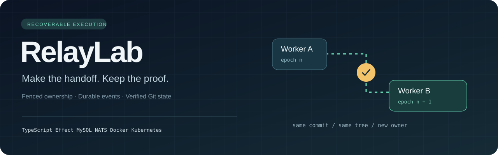
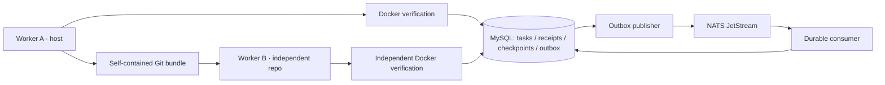

<p align="center"></p>

<p align="center">
  <a href="https://github.com/ns-0437/relaylab/actions/workflows/ci.yml"></a>
  
  
  
</p>

<p align="center"><strong>A coding worker can die. Its verified progress should not disappear.</strong></p>
<p align="center"><a href="#try-the-handoff">Run the demo</a> · <a href="docs/ARCHITECTURE.md">Architecture</a> · <a href="docs/EXECUTION.md">Execution</a> · <a href="docs/KUBERNETES.md">Kubernetes</a> · <a href="docs/VALIDATION.md">Evidence</a></p>

RelayLab explores the infrastructure underneath a dependable coding agent: who owns a task, which command already committed, which Git state was verified, and how another worker can resume it without trusting stale authority.

The demo repairs a small repository, verifies the candidate in a constrained Docker container, records a durable checkpoint, and transfers ownership to a second worker. That worker restores a self-contained Git bundle into an independent repository, verifies it again, and acknowledges the handoff.

**The repair is deterministic.** There is no live LLM, hosted service, or polished agent UI yet. The difficult part explored here is recovery correctness.

## What makes this interesting

| Failure | Mechanism | Where to inspect it |
| --- | --- | --- |
| A stale worker writes after handoff | Ownership epochs and database-time lease checks | [Task store](src/db/task-store.ts) |
| A successful command response is lost | Authorized receipt replay and payload fingerprints | [Retry tests](tests/integration/retry-authorization.test.ts) |
| A broker redelivers after a crash | Transactional outbox, durable deduplication, sequence-gap handling | [Consumer](src/messaging/consumer.ts) |
| A worker dies after producing Git state | Checkpoint identity and reconciliation of committed work | [Crash scenarios](tests/integration/git-worker-crash.ts) |
| An artifact is wrong or incomplete | Bundle digest/size checks and independent restore verification | [Handoff](src/worker/handoff.ts) |
| Verification hangs or changes its input | Runtime/output limits, cleanup, final input-integrity check | [Docker adapter](src/worker/docker-verify.ts) |
| A local service pod is replaced | Persistent state, dependency-aware readiness, explicit exclusivity | [Kubernetes runbook](docs/KUBERNETES.md) |

## How the pieces fit



**In local Kubernetes:** publisher, consumer, MySQL, NATS. **On the host:** Git workers, bundles, and Docker verification. Kubernetes does not schedule verification Jobs in this version.

## Try the handoff

Install **Node 24**, **Git**, and **Docker with Linux containers**. Run commands from the repository root. The Compose configuration uses local development credentials and localhost ports.

```bash
git clone https://github.com/ns-0437/relaylab.git
cd relaylab
npm ci
npm run typecheck
npm run build
npm run test:unit

docker compose -f infra/compose.yaml up -d --wait mysql nats
npm run migrate
npm run docker:build-verify-image
npm run demo:handoff
```

The demo should report matching source/restored Git identities, distinct verification executions, and one logical restoration acknowledgement. These are acceptance conditions, not fabricated sample output.

For setup details, Windows notes, configuration, and troubleshooting, see [Quickstart](docs/QUICKSTART.md). For the local cluster, follow [Kubernetes](docs/KUBERNETES.md).

## Break it deliberately

```bash
# Requires real MySQL, NATS, and the verification image above.
# Uses a disposable test database; run suites sequentially.
npm run test:integration
npm run test:git-worker-crash
npm run test:handoff-crash
```

The harness pauses real child processes at named failure points and terminates them. Recovery assertions inspect durable rows, Git identities, and container state. They do not infer correctness from a clean process exit.

| Validation layer | Infrastructure | Scope |
| --- | --- | --- |
| Build, typecheck, unit tests | Node 24 | Fast checks; automated in CI |
| Integration tests | MySQL, NATS, Docker | Transaction, messaging, Git, and execution behavior |
| Crash scenarios | Real child processes + local dependencies | Recovery across controlled termination points |
| Kubernetes demos | kind, kubectl, local images | Deployment and recovery of coordination services |

[Validation notes](docs/VALIDATION.md) separate fresh publication checks from historical development results. A green CI badge does **not** mean every infrastructure scenario ran in GitHub Actions.

## Stack, with a purpose

| Technology | Responsibility |
| --- | --- |
| TypeScript + Node 24 | Strictly typed services, workers, and process harnesses |
| Effect | Typed task-store service and error boundaries |
| MySQL | Ownership, receipts, checkpoints, outbox, deduplication |
| NATS JetStream | Durable at-least-once event transport |
| Git | Commit/tree identity and portable checkpoint bundles |
| Docker | Bounded local verification execution |
| OpenTelemetry | Traces and context propagation |
| Prometheus + Grafana | Durable-state metrics, alerts, dashboards |
| Kubernetes + kind | Local coordination-service deployment |

Dependency versions are recorded in [package-lock.json](package-lock.json). Vitess compatibility, Electron, Rust, and live model integration are not claimed.

## Design decisions worth reading

- [Ownership fencing](docs/decisions/0001-ownership-fencing.md): an owner name is not enough.
- [Receipt authorization](docs/decisions/0004-receipt-authorization.md): replay is different from a new write.
- [Explicit-path commits](docs/decisions/0010-explicit-path-commits.md): unrelated workspace changes must not enter a checkpoint.
- [Handoff protocol](docs/decisions/0011-handoff-protocol.md): prepare, transfer, restore, verify, acknowledge.
- [Execution design](docs/EXECUTION.md): exact input, cleanup failures, and the limits of container isolation.

<details>
<summary><strong>Repository map</strong></summary>

```text
src/domain/       state transitions and errors
src/db/           transactional task store and migrations
src/messaging/    publisher, consumer, quarantine, exclusivity
src/worker/       Git state, bundles, verification, handoff
src/telemetry/    traces, metrics, health, shutdown
tests/            unit, real-infrastructure, and crash scenarios
infra/            Compose, images, migrations, dashboards, Kubernetes
docs/             architecture, decisions, runbooks, contribution guides
evidence/         historical development summaries
```
</details>

## Boundaries that matter

- This is a local engineering prototype, not a production agent platform.
- The fixed verification command and deterministic repair are project-controlled.
- Docker restrictions and final-state integrity checks are not a hostile-code security boundary. Tamper-then-restore can evade a final-state check.
- Handoff uses local bundle files; it is not cross-machine network transport.
- Durable deduplication does not make arbitrary external side effects exactly-once.
- Caller identity is trusted locally; production authentication and multi-tenant isolation are not implemented.
- The local cluster is not a high-availability or backup solution.

## Next experiments

- Kubernetes Jobs for verification, with explicit artifact transport and cleanup ownership.
- A live coding-model adapter behind the existing verification boundary.
- A task timeline that exposes ownership, retries, verification, and recovery.

These are future work, not features implied by the current repository.

## Contributing and provenance

Start with [CONTRIBUTING.md](CONTRIBUTING.md) and [security boundaries](SECURITY.md). This repository publishes existing local work in a transparent import PR, followed by actual publication improvements. Commits are not backdated and no independent review is implied. See [publication history](docs/PUBLICATION.md).

Built by [Navin Kumar](https://github.com/ns-0437). Independent project inspired by public engineering problems around recoverable coding agents; not affiliated with Capy and not a reproduction of proprietary internals.
